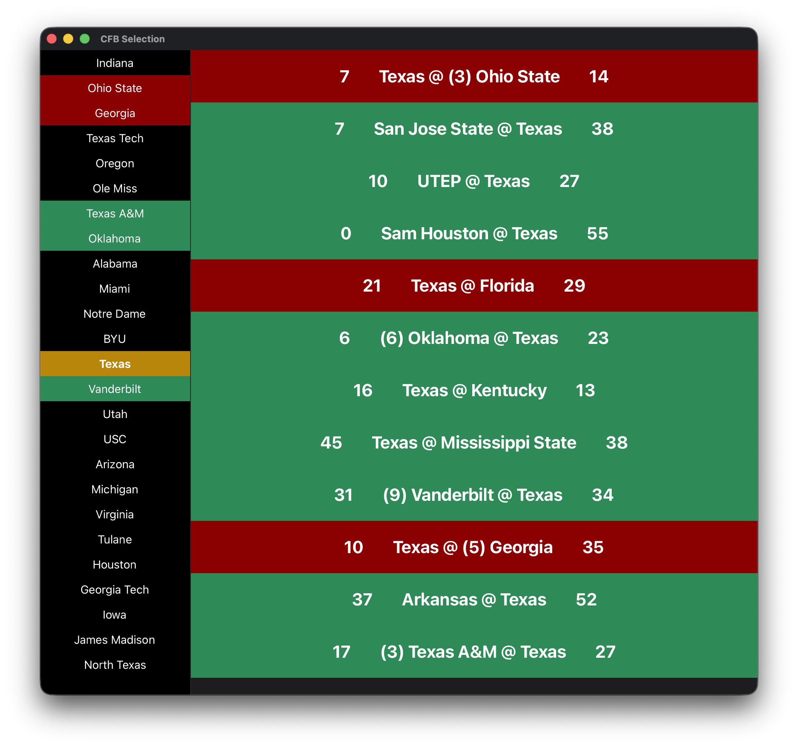

# CFB Selection Visualizer
- quick and dirty program to visualize college football rankings by wins and losses
- top 25 is show on the left panel, the selected teams respective schedule is shown on the right
- wins are green, losses are red, and blue means an upcoming ranked game
- just a fun tool built mostly to explore adwaita/gtk GUI development in rust

### Demo

### Data Source
- All data is from sports-reference.com
- Example: `https://www.sports-reference.com/cfb/schools/indiana/2025-schedule.html`

### Packaging
- [Windows Cross Compilation Example](https://github.com/dagit/annelid)

### Future (unlikely, but who knows)
- [ ] color code based on strength of victory
- [ ] fix miami-fl vs miami-oh bug and miami-fl being considered ranked due to paranthesis
- [ ] clean up sidebar
    - [ ] add ranks
- [ ] clean up schedule
    - [ ] add date
    - [ ] add css on scores
- [ ] add color key
- [ ] port to windows from linux
