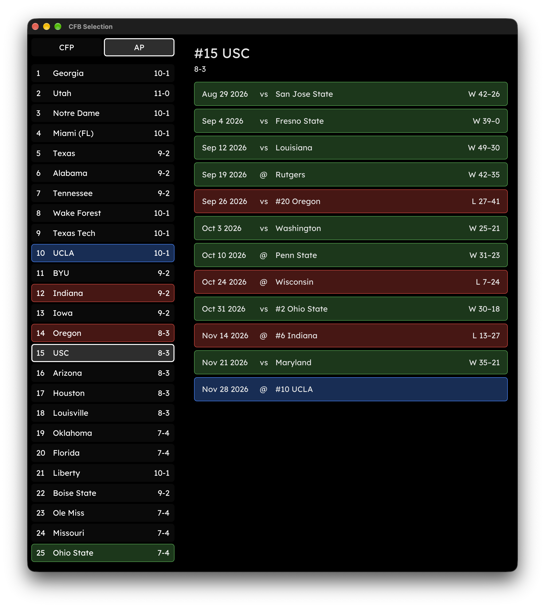

# CFB Selection Visualizer
- quick and dirty program to visualize college football rankings by wins and losses, now in iced rust!
- top 25 is show on the left panel, the selected teams respective schedule is shown on the right
- wins are green, losses are red, and blue means an upcoming ranked game

### Demo


### Data Source
- All data is from [Sports Reference](https://www.sports-reference.com/cfb)
```
https://www.sports-reference.com/cfb/years/2026-polls.html
https://www.sports-reference.com/cfb/schools/indiana/2026-schedule.html
```

### Data Parsing
- generates 1, 2, 3 from other csvs
```bash
cargo run --bin build_games
```

### How to Run
- simple `cargo run` should do the trick ;)

### Windows Cross Compilation
```bash
cargo build --target x86_64-pc-windows-gnu --release
```
